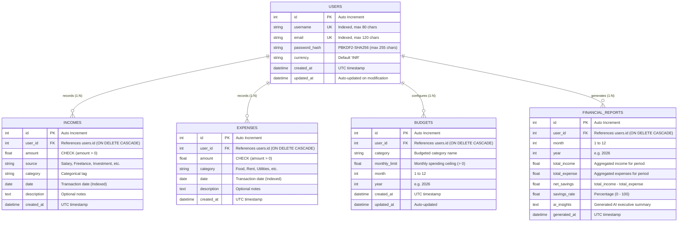

# 02. Database Architecture & Data Models

## Overview
The **Personal Finance Advisor Bot** uses **SQLite 3** managed through **SQLAlchemy 2.0 ORM** (via `Flask-SQLAlchemy`). SQLite was chosen because it provides an ACID-compliant, zero-configuration, serverless SQL database engine stored directly as a file (`database/finance.db`), making it ideal for self-hosted applications, student viva demonstrations, and embedded financial ledgers.

---

## 1. Entity-Relationship Diagram (ERD)



---

## 2. Model Specifications

### 2.1 `User` Model (`models/user.py`)
Represents the authenticated individual within the system.

- **Table Name**: `users`
- **Fields**:
  - `id`: `Integer`, Primary Key.
  - `username`: `String(80)`, Unique, Not Null, Indexed.
  - `email`: `String(120)`, Unique, Not Null, Indexed.
  - `password_hash`: `String(255)`, Not Null.
  - `currency`: `String(10)`, Default `'INR'`, Not Null.
  - `created_at`: `DateTime`, Default `datetime.utcnow`.
  - `updated_at`: `DateTime`, Default `datetime.utcnow`, Onupdate `datetime.utcnow`.
- **Relationships**:
  - `incomes`: One-to-many relationship with `Income`, `cascade="all, delete-orphan"`.
  - `expenses`: One-to-many relationship with `Expense`, `cascade="all, delete-orphan"`.
  - `budgets`: One-to-many relationship with `Budget`, `cascade="all, delete-orphan"`.
  - `reports`: One-to-many relationship with `FinancialReport`, `cascade="all, delete-orphan"`.
- **Security Methods**:
  - `@password.setter`: Automatically executes `generate_password_hash(plaintext_pwd, method='pbkdf2:sha256')`.
  - `check_password(candidate_pwd)`: Uses constant-time `check_password_hash` to resist timing attacks.

### 2.2 `Income` Model (`models/income.py`)
Tracks all cash inflows.

- **Table Name**: `incomes`
- **Fields**:
  - `id`: `Integer`, Primary Key.
  - `user_id`: `Integer`, ForeignKey(`users.id`), Indexed, Not Null.
  - `amount`: `Float`, Not Null (`CheckConstraint('amount > 0')`).
  - `source`: `String(100)`, Not Null (e.g., "Full-time Salary", "Upwork Gig").
  - `category`: `String(50)`, Default `'General'`, Not Null.
  - `date`: `Date`, Indexed, Not Null.
  - `description`: `Text`, Nullable.
  - `created_at`: `DateTime`, Default `datetime.utcnow`.
- **Helper**: `to_dict()` provides JSON-serializable output for REST API queries.

### 2.3 `Expense` Model (`models/expense.py`)
Tracks all cash outflows.

- **Table Name**: `expenses`
- **Fields**:
  - `id`: `Integer`, Primary Key.
  - `user_id`: `Integer`, ForeignKey(`users.id`), Indexed, Not Null.
  - `amount`: `Float`, Not Null (`CheckConstraint('amount > 0')`).
  - `category`: `String(50)`, Indexed, Not Null (e.g., "Food & Dining", "Rent & Housing").
  - `date`: `Date`, Indexed, Not Null.
  - `description`: `Text`, Nullable.
  - `created_at`: `DateTime`, Default `datetime.utcnow`.
- **Helper**: `to_dict()` for frontend consumption.

### 2.4 `Budget` Model (`models/budget.py`)
Defines monthly spending ceilings per expense category.

- **Table Name**: `budgets`
- **Fields**:
  - `id`: `Integer`, Primary Key.
  - `user_id`: `Integer`, ForeignKey(`users.id`), Indexed, Not Null.
  - `category`: `String(50)`, Not Null.
  - `monthly_limit`: `Float`, Not Null (`CheckConstraint('monthly_limit > 0')`).
  - `month`: `Integer`, Not Null (1-12).
  - `year`: `Integer`, Not Null (e.g., 2026).
  - `created_at`: `DateTime`, Default `datetime.utcnow`.
  - `updated_at`: `DateTime`, Default `datetime.utcnow`, Onupdate `datetime.utcnow`.
- **Constraints**:
  - `UniqueConstraint('user_id', 'category', 'month', 'year', name='uq_user_category_month_year')`: Prevents duplicate budget definitions for the same category in the same month.

### 2.5 `FinancialReport` Model (`models/report.py`)
Caches pre-computed monthly financial summaries and AI narrative advice for fast retrieval.

- **Table Name**: `financial_reports`
- **Fields**:
  - `id`: `Integer`, Primary Key.
  - `user_id`: `Integer`, ForeignKey(`users.id`), Indexed, Not Null.
  - `month`: `Integer`, Not Null.
  - `year`: `Integer`, Not Null.
  - `total_income`: `Float`, Default `0.0`.
  - `total_expense`: `Float`, Default `0.0`.
  - `net_savings`: `Float`, Default `0.0`.
  - `savings_rate`: `Float`, Default `0.0`.
  - `ai_insights`: `Text`, Nullable.
  - `generated_at`: `DateTime`, Default `datetime.utcnow`.
- **Constraints**:
  - `UniqueConstraint('user_id', 'month', 'year', name='uq_report_user_month_year')`: Ensures one snapshot per user-month.

---

## 3. The Windows SQLite Absolute Path Gotcha

### The Problem
In **Flask-SQLAlchemy 3.0+**, relative database URIs such as:
```python
SQLALCHEMY_DATABASE_URI = "sqlite:///database/finance.db"
```
are interpreted relative to the Flask application's `app.instance_path` (e.g., `personal-finance-advisor/instance/database/finance.db`). On Windows, if the parent directory does not exist or backslashes are mishandled, SQLite throws:
```text
sqlite3.OperationalError: unable to open database file
```

### The Architectural Solution (`config.py`)
We resolve the path explicitly using Python's `pathlib.Path`:
```python
import os
from pathlib import Path

BASE_DIR = Path(__file__).resolve().parent

raw_db_path = os.getenv("DATABASE_PATH", "database/finance.db")
resolved_path = (BASE_DIR / raw_db_path).resolve()
# Ensure parent directory exists:
resolved_path.parent.mkdir(parents=True, exist_ok=True)

# Format with 3 forward slashes and .as_posix() for uniform cross-platform URI:
SQLALCHEMY_DATABASE_URI = f"sqlite:///{resolved_path.as_posix()}"
```
This guarantees that whether running on Windows 10/11, Linux, or macOS, SQLite resolves directly to `d:/.../database/finance.db`.

---

## 4. Cascading Deletes & Referential Integrity

In SQLite, foreign keys are disabled by default unless explicitly enabled. When using SQLAlchemy with `cascade="all, delete-orphan"`, deleting a `User` entity automatically:
1. Deletes all related `incomes`.
2. Deletes all related `expenses`.
3. Deletes all related `budgets`.
4. Deletes all related `financial_reports`.

This prevents orphaned financial transactions and eliminates privacy leaks if an account is removed.

---

## 5. Database Initialization Script (`init_db.py`)

To initialize the schema and populate sample seed data for viva testing:

```bash
python init_db.py
```

What `init_db.py` does:
1. Calls `db.create_all()` inside `app.app_context()` to create all tables and indexes.
2. Checks if the demo user `demo_user` exists.
3. If missing, registers:
   - **Username**: `demo_user`
   - **Email**: `demo@personalfinance.local`
   - **Password**: `DemoPass@123`
4. Seeds 6 months of realistic transactions:
   - Monthly Salaries (₹65,000/month)
   - Freelance projects (₹12,000 - ₹20,000)
   - Expenses spanning Rent, Food & Dining, Utilities, Transportation, Entertainment, and Healthcare.
   - Configures budget limits across 6 core categories.
