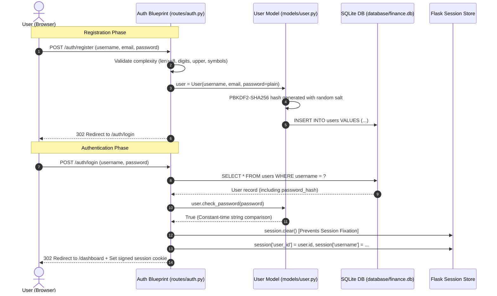

# 03. Security, Authentication & Tenant Isolation

## Overview
Financial systems require stringent security controls to safeguard sensitive monetary data, preserve user privacy, and prevent unauthorized data tampering. This document outlines the security architecture implemented in the **Personal Finance Advisor Bot**, tailored for computer science students and viva panels.

---

## 1. Authentication Architecture & Flow



---

## 2. Password Hashing & Cryptographic Storage

### 2.1 The Threat: Plaintext & Weak Hashes
Storing passwords in plaintext or using fast hashing algorithms (such as MD5 or SHA-1) allows attackers to compromise credentials instantly using precomputed **Rainbow Tables** or GPU brute-force clusters capable of billions of hashes per second.

### 2.2 Our Solution: PBKDF2 with SHA-256
We use **PBKDF2 (Password-Based Key Derivation Function 2)** with HMAC-SHA256, provided via Werkzeug security primitives:
```python
from werkzeug.security import generate_password_hash, check_password_hash

# Inside models/user.py
@password.setter
def password(self, plain_text_password):
    # Generates a unique 16-byte cryptographic salt per user
    # Runs 150,000+ HMAC-SHA256 iterations to slow down brute force attacks
    self.password_hash = generate_password_hash(
        plain_text_password,
        method="pbkdf2:sha256"
    )
```

Stored hash format:
```text
pbkdf2:sha256:600000$w8T...salt...$b98...derived_key...
```

### 2.3 Timing Attack Defense
When validating passwords, string comparison must execute in **constant time**. If comparison terminates on the first mismatched character, an attacker can analyze response latency (sub-millisecond variations) to guess passwords character-by-character.
- `check_password_hash` utilizes Python's `hmac.compare_digest()`, guaranteeing identical execution time regardless of where mismatches occur.

---

## 3. Session Security & Session Fixation Protection

### 3.1 Session Fixation Defense
**Session Fixation** occurs when an attacker tricks a victim into using a known session identifier before authentication. If the server does not regenerate or invalidate the identifier upon login, the attacker retains access to the authenticated session.

In `routes/auth.py`:
```python
@auth_bp.route("/login", methods=["GET", "POST"])
def login():
    if request.method == "POST":
        # ... validation ...
        if user and user.check_password(password):
            # VITAL: Clear existing unauthenticated session state
            session.clear()
            session["user_id"] = user.id
            session["username"] = user.username
            session["currency"] = user.currency
            flash("Welcome back!", "success")
            return redirect(url_for("dashboard.index"))
```

### 3.2 Cookie Flags
Session cookies are configured with hardened flags in `config.py`:
- `SESSION_COOKIE_HTTPONLY = True`: Blocks client-side JavaScript from accessing `document.cookie`, neutralizing session hijacking via XSS.
- `SESSION_COOKIE_SAMESITE = 'Lax'`: Prevents the browser from sending session cookies on cross-origin requests, blocking CSRF attacks on GET navigations.
- `PERMANENT_SESSION_LIFETIME = 86400`: Sessions expire after 24 hours of inactivity.

---

## 4. Multi-Tenant Data Isolation (IDOR Protection)

### 4.1 Insecure Direct Object References (IDOR)
In financial platforms, a catastrophic vulnerability occurs when an endpoint accepts a database record ID (e.g., `DELETE /expenses/<id>`) and deletes it without verifying who owns that record. An attacker could iterate through IDs `1..10000` to wipe out other users' ledgers.

### 4.2 Architectural Enforcement
Every single SQL query in `services/finance_service.py` and `services/budget_service.py` strictly filters by the authenticated `session['user_id']`:

```python
# GOOD: Strictly scoped by user_id
def delete_expense(expense_id: int, user_id: int) -> bool:
    expense = Expense.query.filter_by(id=expense_id, user_id=user_id).first()
    if not expense:
        # Returns False if expense does not exist OR belongs to another user
        return False
    db.session.delete(expense)
    db.session.commit()
    return True
```
Even if an attacker guesses valid IDs of other users, the service layer treats the request as a 404/failure.

---

## 5. Route Protection Decorator (`@login_required`)

A custom Python decorator enforces authentication across protected views:

```python
from functools import wraps
from flask import session, redirect, url_for, flash, request

def login_required(view_func):
    @wraps(view_func)
    def decorated_function(*args, **kwargs):
        if "user_id" not in session:
            flash("Please sign in to access this page.", "warning")
            return redirect(url_for("auth.login", next=request.url))
        return view_func(*args, **kwargs)
    return decorated_function
```

If an unauthenticated request attempts to access `/dashboard`, `/income`, `/expenses`, or `/advisor`, they are redirected to `/auth/login` with their intended target preserved in the `next` parameter.

---

## 6. Cross-Site Scripting (XSS) Defenses

1. **Jinja2 Auto-Escaping**:
   All dynamic strings rendered via `{{ variable }}` are automatically HTML-escaped. `<script>alert(1)</script>` is rendered harmlessly as `&lt;script&gt;alert(1)&lt;/script&gt;`.
2. **AI Markdown Sanitizer (`static/js/advisor.js`)**:
   When rendering AI responses from the Gemini API, markdown tokens (bold, lists, headers) are formatted using safe DOM creation and regex substitutions after all raw HTML special characters (`<`, `>`, `&`, `"`, `'`) have been sanitized:
   ```javascript
   function escapeHtml(text) {
       const div = document.createElement('div');
       div.textContent = text;
       return div.innerHTML;
   }
   ```

---

## 7. Input Validation & Defense in Depth

- **Password Rules**: Minimum 8 characters, at least one uppercase letter, one digit, and one special character (`@$!%*?&`).
- **Amounts**: Guaranteed strictly positive (`amount > 0`) both via HTML5 form validation (`min="0.01" step="0.01"`) and backend database `CheckConstraint('amount > 0')`.
- **Date Inputs**: Validated against ISO 8601 `YYYY-MM-DD` using Python `datetime.strptime`.
- **SQL Injection Defense**: 100% of database interactions utilize SQLAlchemy parameterized queries. No raw SQL string formatting (`f"SELECT * FROM users WHERE username = '{u}'"`) is permitted anywhere in the codebase.
