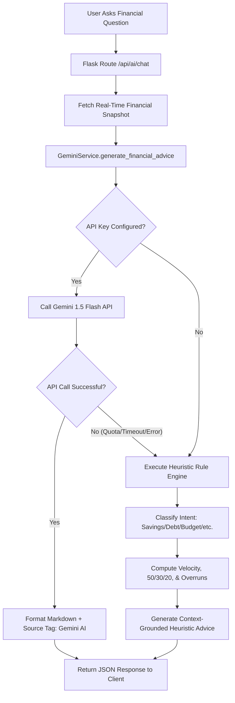

# 04. AI Engine, Prompt Engineering & Offline Fallback

## Overview
The **Personal Finance Advisor Bot** features a **dual-mode intelligent advisory engine**:
1. **Online Mode**: Driven by **Google Gemini 1.5 Flash** via `google-generativeai`, generating contextual, conversational, and tailored financial guidance.
2. **Offline Fallback Mode**: An integrated **Heuristic Financial Rules Engine** that operates with zero network dependencies, ensuring the application remains 100% operational even without an API key or internet access.

---

## 1. Dual-Mode Architecture



---

## 2. Gemini 1.5 Flash Integration

### 2.1 Why Gemini 1.5 Flash?
- **Speed**: Optimized for sub-second responses, ideal for interactive web chats.
- **Context Window**: Supports large context windows allowing detailed ledger histories to be passed without truncation.
- **Instruction Following**: Strictly adheres to formatting and persona constraints.

### 2.2 Client Initialization (`services/gemini_service.py`)
```python
import google.generativeai as genai

class GeminiService:
    def __init__(self, api_key: str = None):
        self.api_key = api_key or os.getenv("GEMINI_API_KEY", "")
        self.is_configured = bool(self.api_key and not self.api_key.startswith("your_"))
        
        if self.is_configured:
            try:
                genai.configure(api_key=self.api_key)
                self.model = genai.GenerativeModel(
                    model_name="gemini-1.5-flash",
                    generation_config={
                        "temperature": 0.7,
                        "top_p": 0.9,
                        "max_output_tokens": 1024,
                    }
                )
            except Exception as e:
                self.is_configured = False
```

---

## 3. Context Grounding & Prompt Engineering

### 3.1 The Problem: AI Hallucinations
A generic LLM prompted with *"How am I doing financially?"* has no awareness of the user's transactions and produces vague platitudes. Worse, it could fabricate false account balances.

### 3.2 The Solution: Grounded Context Injection
Before sending the user prompt to Gemini, `GeminiService` constructs a **Financial Profile Context Block** derived directly from the user's active database records for the current calendar month:

```text
[SYSTEM DIRECTIVE]
You are FinBot, an empathetic, highly knowledgeable certified financial planner.
Analyze the user's query strictly using their actual financial data provided below:

[ACTIVE USER FINANCIAL CONTEXT]
- Currency: INR (₹)
- Period: Current Month (March 2026)
- Monthly Income: ₹65,000.00
- Total Expenses to Date: ₹38,400.00
- Net Savings: ₹26,600.00
- Current Savings Rate: 40.9%
- Top Expense Categories:
  1. Housing & Rent: ₹18,000.00 (46.9%)
  2. Food & Dining: ₹9,800.00 (25.5%)
  3. Utilities: ₹4,500.00 (11.7%)
- Budget Status:
  * Food & Dining: SPENT ₹9,800 of ₹9,000 LIMIT [CRITICAL: EXCEEDED BY ₹800.00]
  * Utilities: SPENT ₹4,500 of ₹5,000 LIMIT [WARNING: 90% UTILIZED]

[RESPONSE GUIDELINES]
1. Address the user's specific question directly.
2. Quote their exact figures to reinforce credibility.
3. Provide 2-3 actionable, high-impact suggestions.
4. Maintain an encouraging yet realistic tone.
5. End with a standard financial disclaimer.
```

---

## 4. Real-Time Auto-Categorization

When a user types an expense description in the Expense entry modal (e.g., *"Starbucks coffee with team"*), the frontend debounces input by 400ms and calls `/api/ai/categorize`.

### 4.1 Tier 1: Instant Heuristic Categorization (< 2ms)
A fast dictionary search checks high-frequency keywords:
```python
KEYWORD_MAPPINGS = {
    "food": ["restaurant", "cafe", "starbucks", "burger", "pizza", "groceries", "swiggy", "zomato"],
    "utilities": ["electricity", "water", "wifi", "internet", "broadband", "mobile recharge"],
    "transportation": ["uber", "ola", "metro", "petrol", "fuel", "diesel", "parking"],
    "entertainment": ["netflix", "spotify", "cinema", "movie", "concert", "steam"],
    "health": ["pharmacy", "medicine", "doctor", "hospital", "clinic", "gym"],
    "housing": ["rent", "maintenance", "mortgage", "property tax"]
}
```

### 4.2 Tier 2: Gemini Zero-Shot Classification
If no keyword matches, the input is submitted to Gemini 1.5 Flash with a constrained prompt:
```text
Classify the expense description '{description}' into exactly ONE of the following categories:
[Food & Dining, Rent & Housing, Utilities, Transportation, Entertainment, Healthcare, Education, Shopping, Other].
Respond ONLY with the category name.
```

---

## 5. Offline Heuristic Rule Engine

When the Gemini API key is absent or offline, `services/gemini_service.py` executes an offline rule engine.

### 5.1 Intent Classification
Analyzes the user's question for tokens:
- **`savings`**: *"How can I save more?", "Where can I cut costs?"*
- **`budget`**: *"Am I over budget?", "Review my spending"*
- **`investment`**: *"Should I invest?", "Where to put my money?"*
- **`debt`**: *"How to pay off loan?", "Credit card balance"*
- **`emergency`**: *"Do I have enough emergency fund?"*

### 5.2 Deterministic Financial Calculations
The offline engine runs real formulas against the user's data:
1. **Savings Rate Evaluation**:
   - `> 30%`: Excellent status.
   - `15% - 30%`: Healthy status.
   - `< 15%`: At-risk warning.
2. **50/30/20 Rule Benchmark**:
   - Needs target: `50% * Income`
   - Wants target: `30% * Income`
   - Savings target: `20% * Income`
3. **Overrun Detection**:
   Identifies any categories where `spent > limit` and generates targeted mitigation advice.

### 5.3 Fallback Indicator
Responses from the offline engine clearly state:
> *Generated by FinBot Offline Heuristic Rules Engine (Deterministic Financial Modeling).*

This ensures full academic honesty during viva presentations.
